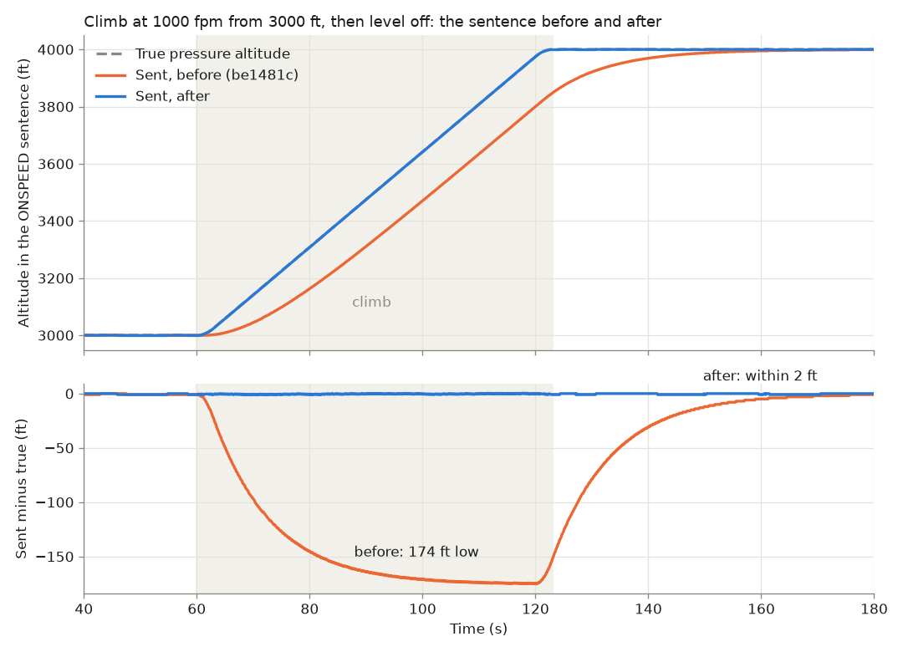

# DisplaySerial altitude lag: host replay

Shows how far the altitude in the serial display sentence trails the aircraft,
before and after the ONSPEED format stopped sending `PaltSmoothed`.

## What it runs

`harness.cpp` compiles the firmware's own `KalmanFilter.cpp` and `DisplaySerial.ino`
on a desktop, with a small Arduino stand-in (`stub/Arduino.h`). Nothing is
re-implemented: the altitude path is the firmware's code, built twice, once from
`be1481c` and once from the working tree.

It flies a synthetic profile: level at 3000 ft for 60 s, climb at 1000 fpm for 60 s
(3 s pull-up and push-over ramps), level for 60 s. The baro/IMU step runs at 208 Hz
and feeds `kalman.Update()` exactly as `AHRS.ino` does, with Gaussian noise of 3 ft
on pressure altitude and 0.02 g on vertical acceleration. `writeSerialData()` is
called after every step and sends on its own 100 ms timer. The harness reads the
PALT field back out of the bytes written to the port.

This is a synthetic profile, not a flight log: the repository holds no logs. The
noise levels are assumptions; they change the jitter figure, not the lag.

## Result



Top: altitude the ONSPEED sentence carries, before (orange) and after (blue); the
dashed true altitude lies under the blue line. Bottom: sent minus true. The shaded
band is the climb.

```
format   version  climb lag (ft)  behind at level-off +0/+5/+10/+20 s (ft)  level jitter (ft, 1 sd)
G3X      base              173.7    152.0    95.0    60.0    23.0             0.36
G3X      new               173.7    152.0    95.0    60.0    23.0             0.36
ONSPEED  base              173.7    152.0    95.0    60.0    23.0             0.36
ONSPEED  new                 0.3      1.0     1.0     0.0     1.0             0.50
```

"Level-off" is the end of the push-over ramp (123 s). Across all 1778 sentences of
each format, the G3X sentence is byte-identical before and after, and the ONSPEED
sentence differs only at offsets 17-20 (the PALT digits) and 76-77 (the checksum).
Full output: `results.txt`.

## Reproduce

```sh
CXX="zig c++" ./run.sh     # or CXX=g++ / clang++; BASE=<sha> to compare another base
python3 plot.py out altitude_before_after.png
```

`run.sh` exits nonzero if anything besides the ONSPEED PALT field and checksum
changed, or if the ONSPEED climb lag is more than 10 ft.
